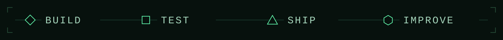

  

I'm **Kelvin**, a full-stack developer working across web applications, backend systems, and deployment automation. I like understanding the whole path: what someone sees, what the API does, where the data goes, and how the application runs.

**Vue & Nuxt on the frontend. PHP & Yii2 on the backend. Linux & Docker underneath.**

## 01 / What I build

- **Business applications:** reservations, point of sale, inventory, procurement, billing, and payroll workflows.
- **Connected systems:** REST APIs, payment integrations, background jobs, and access control for multi-tenant applications.
- **Developer tooling:** code generation, scripts that remove repetitive work, and CI/CD pipelines that get changes into production.

## 02 / Stack matrix

| Layer | Technologies |
| :--- | :--- |
| **Interface** | JavaScript · Vue 3 · Nuxt · Pinia · Vite |
| **Styling** | HTML · CSS / SCSS · Bootstrap · Tailwind CSS |
| **Backend** | PHP · Yii2 · REST APIs · OpenAPI |
| **Data** | PostgreSQL · MySQL · SQLite · Redis |
| **Delivery** | Linux · Docker · Docker Compose · Nginx · GitHub Actions |
| **Quality** | Vitest · PHPUnit · Playwright |
| **Automation** | Python · Bash · Git |

Also worked with **C++**, **Jenkins**, **Vagrant**, and **VirtualBox**. Currently deepening my knowledge of **Kubernetes**, **Terraform**, and cloud infrastructure.

## 03 / Selected work

| Project | Focus |
| :--- | :--- |
| [**Forge**](https://github.com/kiavin/Forge) | OpenAPI tooling for Vue frontend generation, with schema parsing and analysis. |
| [**Trustify**](https://github.com/kiavin/Trustify) | Blockchain-based escrow using Rust, Vue, and the Internet Computer. Currently on hold. |
| [**Urbanloos**](https://github.com/kiavin/Urbanloos-nuxt3) | A responsive website showcasing mobile toilet units and services. |

[Explore more repositories →](https://github.com/kiavin?tab=repositories)

## 04 / Current direction

I'm growing further into **DevOps and infrastructure automation** while continuing to build full-stack products. My focus is on reliable deployments, useful tests, clear permission boundaries, and systems that are easier to operate as they grow.

I also enjoy exploring **IoT**, **smart utility metering**, and **security in my own development environments**.

  

## 05 / Connect

Open to conversations about full-stack development, automation, and useful things we can build together.

**[GitHub](https://github.com/kiavin)** &nbsp; / &nbsp; **[Email](mailto:kiarie.email@gmail.com)** &nbsp; / &nbsp; **[Activity](https://github.com/kiavin?tab=overview)**

About the black-hole header

The disk image uses numerical Kerr ray tracing. The animated skill labels are a visual metaphor. [See the model, approximations, and scientific references.](./assets/BLACK_HOLE.md)

